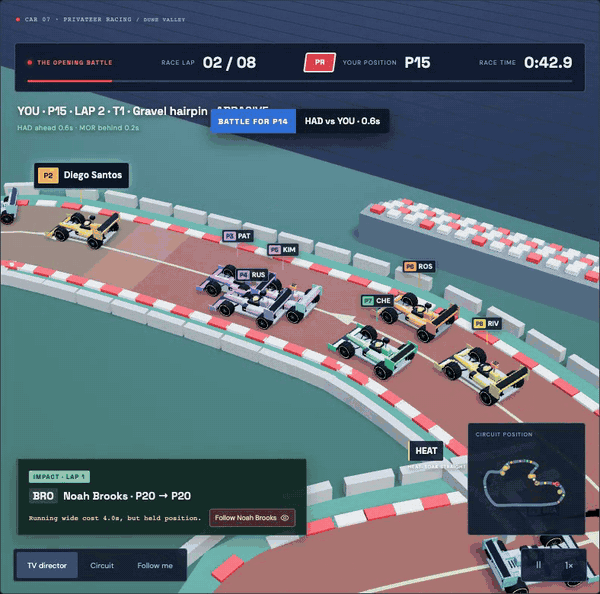
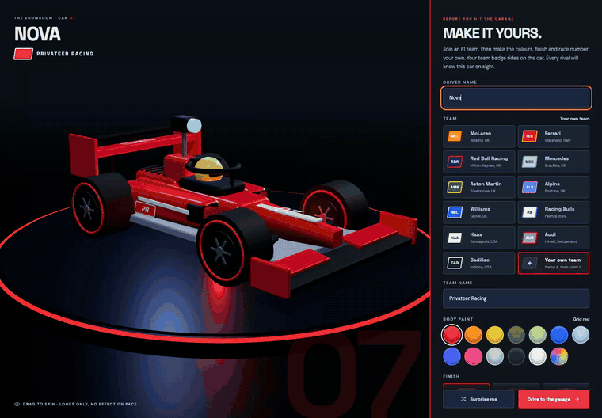
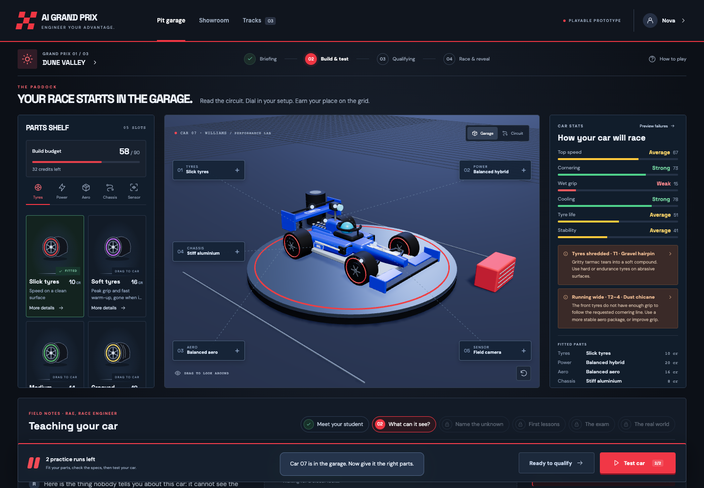
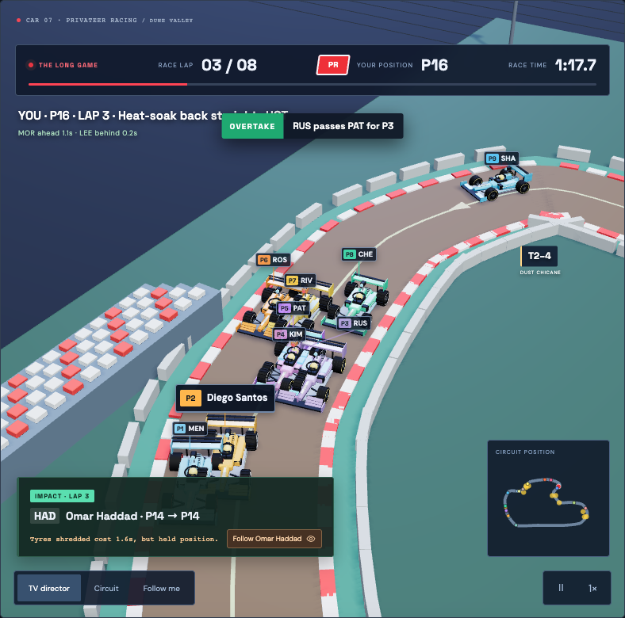
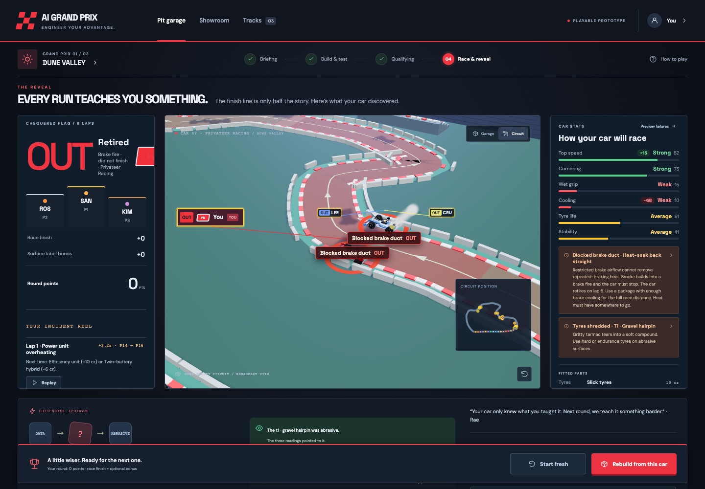

<div align="center">

# AI Grand Prix

**Build a car. Teach it the track. Race 19 rivals.**

A browser racing game about how AI learns: your car only knows what you teach it.



</div>

---

## How a round works

<table>
<tr>
<td width="50%" valign="top">

### 1 · Make it yours
Pick one of 11 F1 teams or name your own, then choose paint, finish, stripes, helmet and race number on a spotlit turntable. Looks only, no effect on pace.

</td>
<td width="50%"></td>
</tr>
<tr>
<td width="50%"></td>
<td width="50%" valign="top">

### 2 · Build and test
Drag parts onto the 3D car across five slots: tyres, power, aero, chassis and sensor. You have 90 credits, which isn't enough for the best of everything. Two test laps show where your car struggles.

</td>
</tr>
<tr>
<td width="50%" valign="top">

### 3 · Race
Eight laps against 19 rivals in about 3 minutes, with TV-style cameras, a live timing tower and race chat. If a section is beyond your car, you lose time, and the race pauses to show what happened.

</td>
<td width="50%"></td>
</tr>
<tr>
<td width="50%"></td>
<td width="50%" valign="top">

### 4 · Learn and rebuild
The results show your finishing place, a replay of every incident, and what the race revealed about the track. Rebuild from the same car and try again.

</td>
</tr>
</table>

## Play it

Needs Node.js 22.12 or newer.

```sh
npm install
npm run dev
```

Then open **http://127.0.0.1:4174**. On macOS you can also double-click **Start Preview.command**.

## What's inside

|  |  |
|---|---|
| **3 tracks** | Dune Valley (hot, abrasive), Mountain Pass (cold, wet), Quarry Ring (bumpy). Each has 4–5 sections that test different parts of the car. |
| **28 parts** | 9 tyres, 6 power units, 5 aero packages, 4 chassis and 4 sensors, each with its own look on the car. No single build wins on every track. |
| **Incidents** | Most cost a few seconds, and a crash costs more. Only a brake fire puts you out of the race. Each one is warned about ahead of time and replayable afterwards. |
| **Broadcast view** | TV director, circuit and follow cameras, picture-in-picture for simultaneous incidents, a minimap, and callouts for overtakes and battles. |
| **Race chat** | Race control, rivals reacting to what happens on track, and your own messages and reactions. |
| **Field notes** | Rae, your race engineer, explains each step as teaching an AI: data → label → training → validation → real world. |

<details>
<summary><b>How it's built</b></summary>

<br>

Vanilla JavaScript, [Vite](https://vitejs.dev) and [three.js](https://threejs.org). No framework, no backend.

- `shared/` holds the game rules: parts, tracks, race timeline and incidents. They are pure and deterministic, and ready to move to a server unchanged.
- `src/adapters/local-session.js` is the session. Views read snapshots and send commands, and never decide outcomes themselves.
- `src/ui/` builds the interface and `src/scene/` draws the 3D garage, showroom and circuit.

Races are authored and repeatable, not a physics simulation. The 19 rivals and the chat are simulated, and refreshing the page starts a new session.

</details>

<details>
<summary><b>Tests</b></summary>

<br>

```sh
npm test               # game rules, including a balance check on every affordable build
npm run build          # production bundle
npm run test:browser   # Playwright, plays full races, takes a few minutes
```

If Chromium is missing, run `npx playwright install chromium`.

</details>

<details>
<summary><b>Team logos</b></summary>

<br>

No official logos are included. Each team shows an original badge in its colours. Logo files you have permission to use can be added to `public/team-logos/` (see the README there).

</details>

<br>

<div align="center"><sub>An independent prototype. Not affiliated with Formula 1 or any team.</sub></div>
